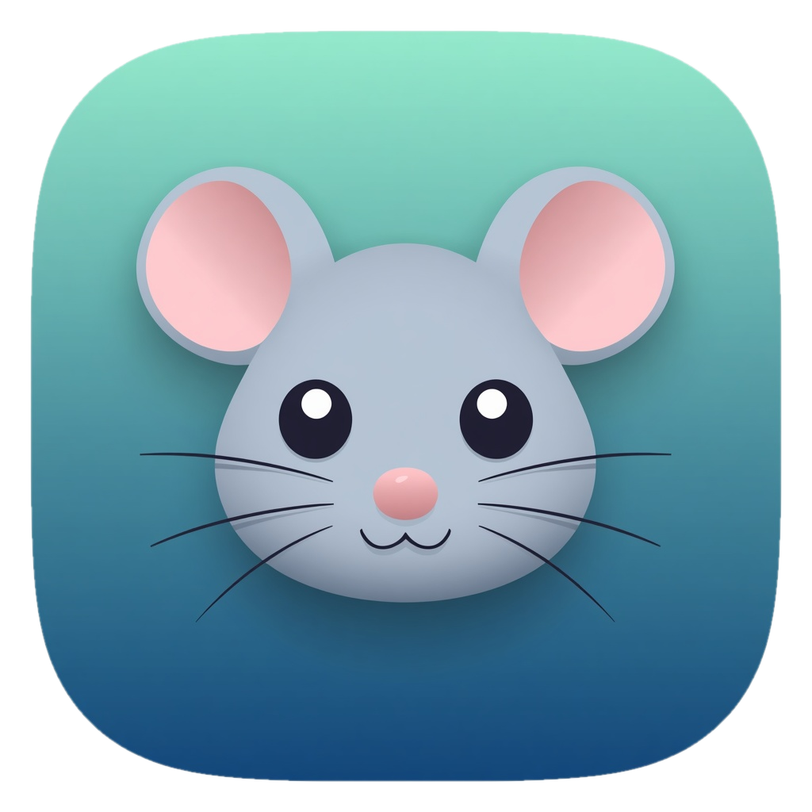

<p align="center">
  
</p>

<h1 align="center">tinymousy</h1>

<p align="center">
  A tiny macOS menu-bar mouse mover that keeps you <b>active</b> in Teams, Slack and anything else with an idle timer.
</p>

---

## Why

Teams flips you to "Away" after a few minutes without input. Your Mac locks the screen. Your session times out while you're reading a doc or on a call. **tinymousy** sits quietly in the menu bar and nudges the cursor by 1 pixel and back on a schedule, so macOS sees activity and the idle timers reset.

## Features

- **Menu bar only**: no Dock icon, no windows in your way
- **Run for as long as you need**: until stopped, 30 min, 1 h, 2 h, 4 h or 8 h
- **Choose how often it moves**: every 30 s, 1 min or 2 min
- **Auto-stop**: switches itself off when the timer ends
- **At-a-glance status**: the tray icon changes when it's running
- **Tiny**: about 90 lines of JavaScript, built with tinyjs and a native webview, no Electron

## Usage

1. Click the mouse icon in the menu bar.
2. Pick **Run for** and **Move** settings.
3. Hit **Start**. Hit **Stop** (or wait for the timer) when you're done.

> **First run:** macOS will ask for Accessibility access. Grant it under
> *System Settings → Privacy & Security → Accessibility*, otherwise the cursor can't be moved.

## Build from source

Requires macOS and the tinyjs CLI.

```sh
git clone https://github.com/RomAnoX/tinymousy.git
cd tinymousy
tinyjs dev     # run in development
tinyjs build   # produces dist/tinymousy.app
```

## How it works

On every tick `src/main.js` runs a short JXA (JavaScript for Automation) script through `osascript`. It reads the current cursor position with CoreGraphics and posts a 1 px mouse-move event and a move back, which is enough to reset the system idle timer without visibly disturbing your work.

## Platform

macOS only.

## Disclaimer

Use it responsibly. Check your employer's policies on activity-status tools before relying on it.
